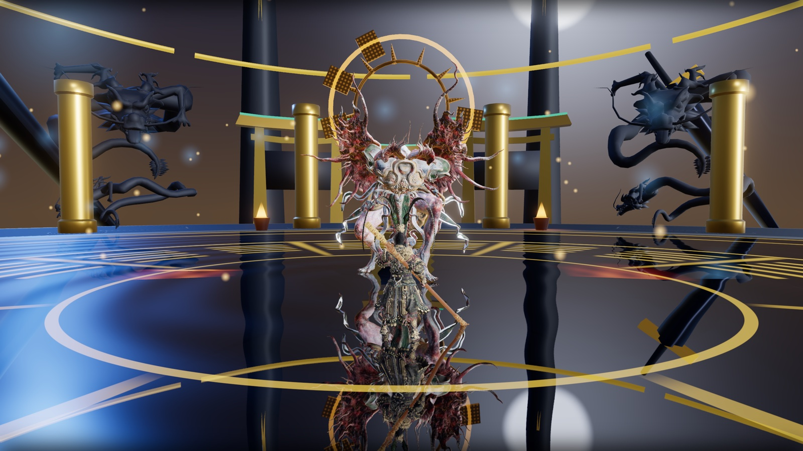
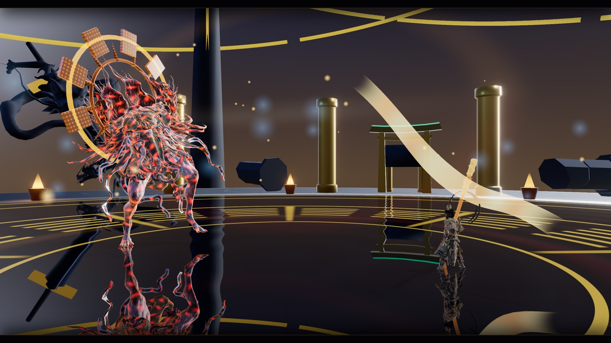
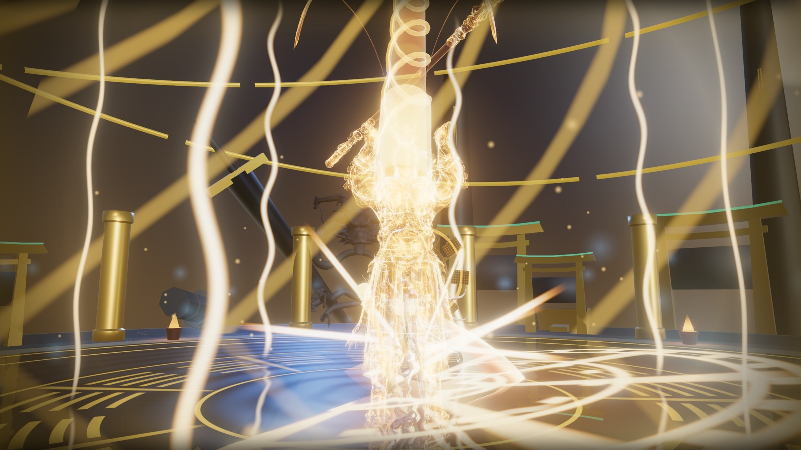

# Black Myth: Celestial Severance

A real-time 3D WebGPU 1v1 Eastern-myth boss battle built with **Three.js (`three/webgpu` + TSL `NodeMaterial`)** and **TypeScript**, featuring **Sun Wukong** confronting the fallen celestial demon general **Jiebo** inside an obsidian water-mirror temple arena.



---

## Highlights

- **100% WebGPU + TSL NodeMaterial Pipeline**: Built on Three.js `WebGPURenderer` (with automatic WebGL2 fallback), offscreen `4x MSAA + SMAA` post-processing, tuned HDR bloom, `8x` anisotropic texture filtering, and asynchronous shader pre-warming (`prewarmScene()`).
- **Obsidian Water-Mirror Temple Arena**: Real-time planar `reflector()` (`0.75x` resolution at `4x MSAA`) with `fwidth()` screen-space anti-aliased Bagua floor inlays, layer-culled reflection passes (`RenderLayers.ts`), and single-pass shadow deduplication.
- **8.0-Second 4-Shot Opening Cinematic**:
  1. **Meteor Descent**: Demon General Jiebo crashes onto the water-mirror floor amid molten spiderweb fissures and rotating Dharma halo rings.
  2. **Somersault Cloud Touchdown**: Sun Wukong streaks down on a golden Somersault Cloud into a grounded one-knee martial crouch.
  3. **Ear-Needle Conjuration**: Wukong plucks the miniature golden needle from his right ear, telescoping the Ruyi Jingu Bang into a full divine polearm slam.
  4. **Twin-Titan Standoff & One-Take Whip-Orbit**: Symmetrical wide profile standoff across the mirror floor that whips seamlessly behind Wukong's shoulder into live combat (skippable anytime via `Esc`, `Space`, `Enter`, or click).
- **6-Pose Martial Choreography & Tiered Hit Reactions**:
  - Shoulder-rest idle stance, low-lean drag-staff sprint with ground sparks, phantom-step hair-clone dodge, wide bow-horse sweeps, and mid-air overhead heavy smash with two-bone left-hand IK and non-recursive bone world-matrix updates.
  - Tiered **Light Hit** (two-handed horizontal staff-brace boot skid) vs **Heavy Hit** (parabolic knockdown, ground crash, and Golden Lotus kip-up vault).
- **Three Divine Skills & Two-Phase Boss Spectacles**:
  - **Skill `1` — Pluck of Many**: Summons four golden hair clones converging on the boss in a synchronized staff-cage flurry.
  - **Skill `2` — Pillar Stance Dragon Cleave**: Perches high atop an ascending golden pillar before driving a `16.5m` carved dragon-pillar smash across a `21m` molten fissure.
  - **Skill `3` — Dharmakaya Domain**: Freezes world time inside a `26m` rotating Sanskrit mantra circle while manifesting a towering `14.6m` molten-gold Great Sage Dharmakaya.
- **5-Act Dynamic Soundtrack**: Seamless state-driven transitions across Title Overture, Phase I Chant Rock, Phase II Deity Choir, Finisher Climax, and Victory Theme, paired with bullet-time low-pass audio filtering.

| Opening Twin-Titan Standoff | Skill `3` — Great Sage Dharmakaya |
| :---: | :---: |
|  |  |

---

## Controls

| Input | Action |
| :--- | :--- |
| `W` `A` `S` `D` / Arrow Keys | Move |
| `Shift` (hold) | Drag-Staff Sprint |
| Mouse Move / Drag | Orbit Camera |
| Left Click / `J` | Light / Combo Staff Sweep (hold or chain for Heavy Leap Smash) |
| `Space` | Phantom-Step Dodge (triggers Bullet-Time on Perfect Dodge) |
| `1` | **Skill 1**: Pluck of Many (Four Golden Clones) |
| `2` | **Skill 2**: Pillar Stance Dragon Cleave |
| `3` | **Skill 3**: Dharmakaya Time-Stop Domain |
| `Esc` | Skip Cinematic / Pause Menu |

---

## Quick Start

### Prerequisites

- **Node.js** `>= 20`
- A modern Chromium/Chrome, Edge, or Safari browser with **WebGPU** enabled (automatically falls back to WebGL2 if WebGPU is unavailable)

### Install & Run

```bash
npm install
npm run dev
```

Build and preview the production bundle:

```bash
npm run build
npm run preview
```

### Verification Suite

```bash
# TypeScript check + production Vite bundle
npm run build

# Unit tests (Vitest)
npm run test:unit

# End-to-end browser verification (Playwright)
npm run test:e2e
```

---

## Project Structure

```text
src/
├── audio/        # Web Audio API 5-act BGM crossfader, bullet-time filter & procedural/sample SFX
├── combat/       # Deterministic 1v1 combat resolver, posture/stagger & 6-phase state machine
├── debug/        # Deterministic test harness & real-time WebGPU draw/triangle/CPU telemetry
├── engine/       # WebGPURenderer + SMAA/Bloom post-processing, AssetLoader & TimeScaleSystem
├── entities/     # Sun Wukong 6-pose IK rig & Demon General Jiebo 2-phase boss choreography
├── scene/        # Obsidian Water-Mirror reflector arena, RenderLayers & AtmosphereController
├── types/        # Shared combat tuning constants & strict TypeScript contracts
├── ui/           # Cinema letterbox framing, Title/Pause/Victory screens & optional HUD
└── vfx/          # 100% TSL NodeMaterial VFX (clones, dragon pillar, Dharmakaya & boss spectacles)
```

---

## License

First-party source code in this repository is licensed under the [MIT License](LICENSE). Bundled third-party 3D models, environment maps, and audio tracks under `public/assets/` remain under their respective Creative Commons licenses (`CC0-1.0` and `CC-BY-4.0`); see [THIRD_PARTY_LICENSES.md](THIRD_PARTY_LICENSES.md) for complete details.

---

## Acknowledgements

- Character 3D models (`hero_wukong.glb`, `boss_jiebo.glb`) by **hakudragons** on Sketchfab (`CC-BY-4.0`), fallback character/weapon/dungeon assets by **Quaternius**, **Kay Lousberg**, and **Grab3D** (`CC0-1.0`), and temple architectural props from the **Polygonal Mind** Lunar Year Pack (`CC0-1.0`).
- 2K Radiance HDRI skies (`clarens_night_01_2k.hdr`, `dikhololo_sunset_2k.hdr`) from **Poly Haven** (`CC0-1.0`).
- 5-act boss battle soundtrack (`Wuxia3`, `EpicBattle_J`, `EpicBattle_Deity`, `Kengeki`, `Wuxia2`) composed by **Sei Mutsuki / PeriTune** (`CC-BY-4.0`), alongside **Kenney** and **OpenGameArt** `CC0-1.0` sound effects.
- Full per-file provenance, source URLs, and license terms are documented in [THIRD_PARTY_LICENSES.md](THIRD_PARTY_LICENSES.md).
